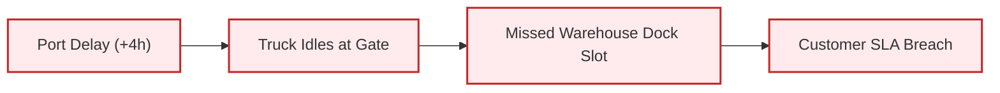
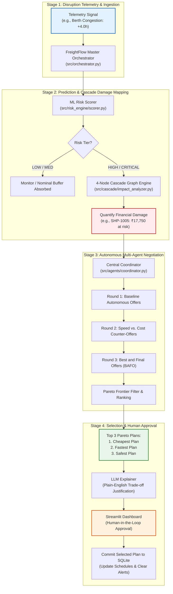
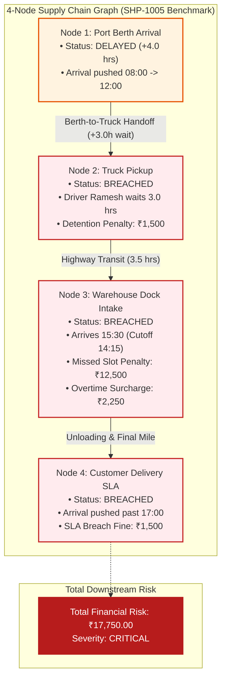
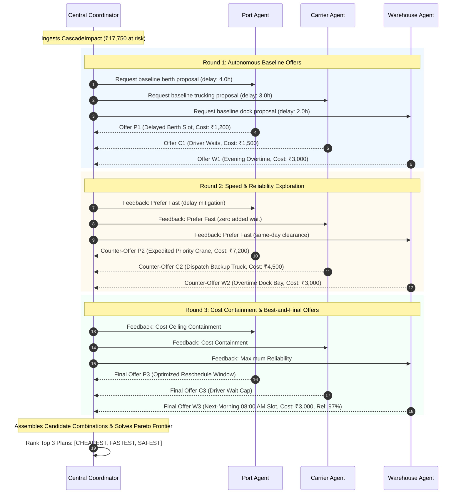

# FreightFlow AI: System Architecture, Workflow & Status Guide

> **Core Value Proposition:** Move logistics disruption handling from reactive phone/email alerts to **proactive ML prediction** and **autonomous multi-agent negotiation**, presenting the human supervisor with the **Top 3 Pareto-optimal recovery plans** (Cheapest, Fastest, Safest).

---

## 1. High-Level Concept & Problem Alignment

Modern multimodal freight operates in silos (Port Berth $\to$ Long-haul Carrier $\to$ Warehouse Dock $\to$ End Customer). When an upstream delay occurs (e.g. ship delayed 4 hours at the port), the failure cascades down the entire chain, multiplying costs through driver detention, forfeited dock appointments, and customer SLA breach penalties.



**FreightFlow AI solves this with a 4-step autonomous pipeline:**
1. **Predict Risk:** Don't wait for late arrivals; classify delay risk using real-time telemetry.
2. **Quantify Financial Cascade:** Map downstream bottlenecks on a directed dependency graph and calculate exact monetary damage ($\text{₹}$ at risk).
3. **Decentralized Agent Negotiation:** Autonomous software agents representing the Port, Carrier, and Warehouse negotiate trade-offs over 3 rounds without exposing private profit margins.
4. **Human-in-the-Loop Selection:** The coordinator filters candidate plans down to the **Top 3 Pareto recovery plans** (Cheapest, Fastest, Safest) with plain-English LLM justifications for the human operator to approve.

---

## 2. End-to-End System Workflow Flowchart



---

## 3. The 4-Node Cascade Graph Explained

The cascade graph represents the four dependent stages of a consignment lifecycle. If upstream Node 1 is delayed, downstream nodes inherit delays minus their operational buffers.



### Exact Penalty Calculations (Benchmark Consignment `SHP-1005`):
1. **Driver Waiting Fee (Detention):**
   $$3.0\text{ hrs wait} \times ₹500/\text{hr} = \mathbf{₹ 1,500.00}$$
2. **Missed Warehouse Dock Slot:**
   Late arrival beyond 45-min buffer = $\mathbf{₹ 12,500.00}$ (fixed forfeiture penalty)
3. **Warehouse Overtime Labor:**
   $1.25\text{ hrs late unloading} \times ₹1,800/\text{hr} = \mathbf{₹ 2,250.00}$
4. **Customer SLA Breach:**
   $0.5\text{ hrs delivery delay} \times ₹3,000/\text{hr} = \mathbf{₹ 1,500.00}$
5. **Total Cascaded Damage:** $\mathbf{₹ 17,750.00}$

---

## 4. Multi-Agent Negotiation Architecture

Instead of human dispatchers making dozens of urgent phone calls, the **Central Coordinator** orchestrates a 3-round negotiation between the domain agents:



### The 3 Recovered Options Presented to the Human:
* 🟢 **Cheapest Plan:** Minimizes financial surcharges (Driver waits, delayed berth, morning intake). Saves the most money; higher delivery delay.
* ⚡ **Fastest Plan:** Minimizes total delay (Priority crane offloading, immediate backup truck dispatch, evening overtime crew). Zero extra transit delay; higher cost.
* 🛡️ **Safest Plan:** Maximizes schedule reliability (Buffered berth slot, scheduled intake with 98% on-time confidence).

---

## 5. File Relationship & Component Architecture

```
Freight_Flow_AI/
├── schemas.py / src/common/schemas.py  ──► [Data Contracts]: DisruptionEvent, CascadeImpact, RecoveryPlan
├── generate_data.py                    ──► [Seeder]: Populates SQLite freightflow.db (1,200 records + SHP-1005)
│
├── src/risk_engine/                    ──► [Stage 1]: ML Model (scikit-learn GradientBoosting)
│   ├── scorer.py                       ──► predict_risk(shipment, delay, congestion) -> LOW/MED/HIGH/CRITICAL
│   └── train.py                        ──► Offline synthetic model training routine
│
├── src/cascade/                        ──► [Stage 2]: NetworkX 4-Node Cascade DAG
│   ├── graph_builder.py                ──► Builds Port -> Truck -> Warehouse -> Customer graph
│   └── impact_analyzer.py              ──► compute_cascade_impact() -> calculates ₹17,750 at risk
│
├── src/agents/                         ──► [Stage 3]: Autonomous Multi-Agent Negotiation
│   ├── port_agent.py                   ──► Port terminal cost & berth availability
│   ├── carrier_agent.py                ──► Fleet dispatch, driver wait fees, backup trucks
│   ├── warehouse_agent.py              ──► Dock intake bays, evening overtime, morning slots
│   └── coordinator.py                  ──► 3-round coordinator & Pareto frontier solver
│
├── src/orchestrator.py                 ──► [Master Conductor]: Pipeline running Stage 1 -> 2 -> 3 -> 4
├── src/llm/explainer.py                ──► [Stage 4]: Plain-English justification of recovery trade-offs
│
├── src/dashboard/                      ──► [Frontend UI]: Streamlit dashboard
│   ├── app.py                          ──► Navigation & layout entry point
│   └── components/                     ──► Visualizers (cascade graph, plan cards, approval button)
│
└── src/simulation/                     ──► [Benchmark Harness]: 50-run simulation vs. baseline
    └── benchmark_runner.py             ──► Validates delay reduction and cost savings metrics
```

---

## 6. Implementation Status Matrix

| Subsystem | Key Files | What Is Done | Current Status |
| :--- | :--- | :--- | :---: |
| **Database & Seeder** | `generate_data.py`<br>`src/database/` | Realistic schema with 1,200 shipments and flagship fixture `SHP-1005`. | ✅ **100% DONE** |
| **ML Risk Engine** | `src/risk_engine/scorer.py`<br>`train.py` | Gradient Boosting classifier predicting risk level and confidence. | ✅ **100% DONE** |
| **Cascade Graph** | `src/cascade/impact_analyzer.py` | 4-node NetworkX DAG calculating exact penalties (₹17,750 at risk). | ✅ **100% DONE** |
| **Agent Negotiation** | `src/agents/*.py`<br>`coordinator.py` | 3 rounds of offer/counter-offer and Pareto ranking (Cheapest, Fastest, Safest). | ✅ **100% DONE** |
| **Master Orchestrator** | `src/orchestrator.py` | Master pipeline executing Risk $\to$ Cascade $\to$ Negotiation $\to$ Ranking. | ✅ **100% DONE** |
| **Automated Tests** | `tests/` | 81 passing unit and integration tests across all modules. | ✅ **100% DONE** |
| **LLM Explainer** | `src/llm/explainer.py` | Structured explanation template written; external Gemini API call optional. | ⚠️ **PARTIAL** |
| **Streamlit Web UI** | `src/dashboard/app.py` | UI layout created; needs data binding to render live graph and plan cards. | ⏳ **IN PROGRESS** |
| **50-Run Benchmark** | `src/simulation/` | Stub created; needs simulation loop comparing baseline vs. AI. | ⏳ **IN PROGRESS** |

---

## 7. Immediate Next Steps for Hackathon Demo Readiness

1. **Wire the Streamlit Dashboard (`src/dashboard/`):**
   - Connect the UI to `FreightFlowOrchestrator`.
   - Add a dropdown to select `"SHP-1005"` and a button to inject the 4-hour delay.
   - Display the 4-node cascade visualizer and 3 clickable plan cards with the LLM reasoning box.
2. **Implement the 50-Run Simulation Benchmark (`src/simulation/`):**
   - Run 50 randomized disruption events against a First-Come, First-Served baseline.
   - Display the aggregate comparison chart (e.g. 42% delay reduction, 65% idle driver reduction) for Slide 6 proof.
